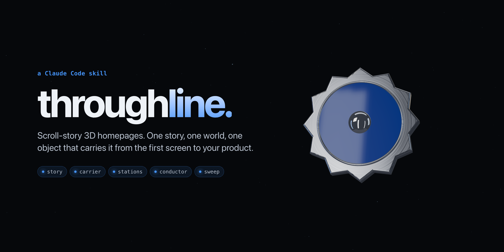
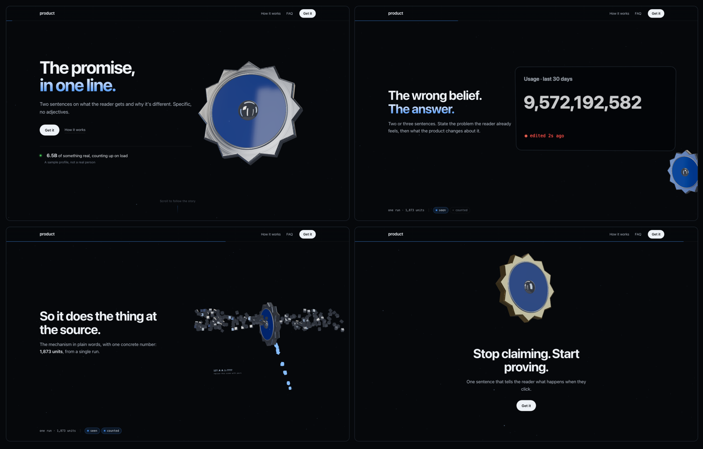

<p align="center">
  
</p>

<p align="center">
  <b>A Claude Code skill that builds scroll-story 3D homepages.</b><br>
  One story, one Three.js world, one object that carries it from the first screen to your product.
</p>

<p align="center">
  <a href="https://tokenproof.pages.dev">Live example</a> ·
  <a href="#install">Install</a> ·
  <a href="#how-it-works">How it works</a> ·
  <a href="#whats-inside">What's inside</a>
</p>

---

Most landing pages are a hero and six feature cards. You scroll and nothing happens.

throughline builds the other kind. Each chapter of your product's story is a scene in one 3D world. As
the reader scrolls, the camera glides from scene to scene, and one object (a seal, a key, a lens,
whatever your product owns) travels through all of them and lands on the real thing at the end. The
copy fades in with each scene and never gets cut off, on a 4K monitor or a phone.

It's the method behind [tokenproof.pages.dev](https://tokenproof.pages.dev), packaged so Claude can do
it again for a different product, with a different story, and have it come out looking like that
product and not like tokenproof.

## Install

**As a plugin** (Claude Code):

```
/plugin marketplace add alii13/throughline
/plugin install throughline@throughline
```

**Or copy the skill** into your skills folder:

```bash
git clone https://github.com/alii13/throughline
cp -r throughline/skills/scroll-story-site ~/.claude/skills/
```

Start a new Claude Code session and it's available. It triggers on its own when you ask for a 3D
homepage, a scroll story, scrollytelling, or "a site like tokenproof".

## Use it

Give it a product. A storyline helps but isn't required.

```
Build a scroll-story homepage for "latchkey", a CLI that gives AI agents scoped,
expiring access to cloud accounts. Brand colour is amber on near-black.
Storyline: the problem is long-lived admin tokens pasted into agent envs; latchkey
mints a key that opens one door, dies after 15 minutes, and logs every use.
```

```
make me a landing page for "reel", a mac app that turns a folder of screen
recordings into one highlight video with captions. calm, not techy. teal and
off-white. one-time $29.
```

Claude drafts the story as a table first (one row per chapter: the headline, the one object in the
scene, what the carrier does there) and shows it to you before writing any code. Change the table
and the site changes with it.

## How it works

<p align="center">
  
</p>

<p align="center"><sub>The starter world that ships with the skill, before any product is put into it.</sub></p>

The skill splits the work in two.

**The plumbing is solved and reused.** A scroll conductor that turns native scroll into a camera
path, chapter poses stored as data, copy panels that crossfade with the camera and shrink their type
until they fit, a fallback for browsers without WebGL, and a screenshot sweep that checks every
chapter at four screen sizes. None of it uses a scroll library.

**The story is derived every time.** The carrier object, the palette, the material family, the
number and order of chapters, and every scene come from the product. A proof tool gets a seal that
stamps things. An auth tool gets a key that opens doors. A video tool gets a film frame. A calm
consumer app gets matte ceramic instead of chrome. Before handing anything back, Claude runs a
sameness check against tokenproof and goes back to the story if too much matches.

The method, in order:

1. **Story.** Derive the carrier, palette, arc and scenes. Show the chapter table.
2. **Page.** Set up the HTML from the template: chapters as scroll spacers, copy panels, data handoff,
   fit script, fallback.
3. **World.** Studio lighting, the material family, the carrier, one station per chapter, poses as
   data, and the landing on the real artefact.
4. **Conductor.** Tune the feel, one number at a time.
5. **Sweep.** Screenshot every chapter at 1440, 1180, 1024 and phone width; fix what's cut off or
   overlapping.
6. **Finish.** Reduced motion, SEO and share cards, performance, the sameness check.

### The feel, in four numbers

These took many rounds of "too fast", "feels stuck" and "it floats" to get right. Start from them.

| Constant | Value | What it does |
|---|---|---|
| smoothing | 0.2 s | How far the world trails the scrollbar. Measured on wall time, so a slow frame never leaves it behind. |
| `HOLD` | 0.3 | The camera rests on a chapter for the first 30% of its scroll so the reader can read. |
| `PUSH` | 0.07 | During that rest the camera eases 7% closer, so scrolling never feels stuck. |
| `ACT` | 0.6 | Each scene's own action finishes by 60% of the chapter, before the camera leaves. |

Everything is a function of scroll position, so scrolling back up plays every scene in reverse.

## What's inside

```
skills/scroll-story-site/
├── SKILL.md                      the method, with a check at every step
├── assets/
│   ├── index.template.html       the page contract: chapters, copy panels, fit script, fallback
│   └── world.template.js         studio, materials, a placeholder carrier, the full conductor (runs as is)
├── references/
│   ├── variation.md              deriving carrier, palette, materials, arc and scenes; the sameness check
│   ├── scene-cookbook.md         14 shipped scenes with code: shatter, stream, stamp, scan, glass, landing...
│   ├── world-architecture.md     every formula in the conductor, and why
│   ├── page-contract.md          the CSS and HTML the world depends on
│   ├── story-patterns.md         a worked 12-chapter arc, headline and copy rules
│   └── gotchas.md                mistakes already made once
├── scripts/
│   └── sweep.sh                  screenshots every chapter at four viewports
└── evals/                        two test prompts with graders
```

## Requirements

- Claude Code (or any agent that reads `SKILL.md` skills).
- A static file server to preview the site, for example `python3 -m http.server`.
- [agent-browser](https://github.com/vercel-labs/agent-browser) for the screenshot sweep. Optional;
  without it, check the chapters by hand.
- Three.js loads from jsDelivr through an import map, pinned to an exact version. Nothing to
  install.

## Tests

`skills/scroll-story-site/evals/` holds two test prompts written to force variety: an amber,
key-based auth tool with a storyline given, and a calm teal video app with none. Each has graders
that check the output is derived from the product rather than copied from the template. With
Claude Code 2.1.269 or later, run them from the skill folder:

```bash
claude plugin eval . --allow-tools Write,Edit,Bash
```

These are real model runs and cost tokens.

## Credits

- The metal look follows Meng To's 3d-metal-material approach (a dark studio of bright cards baked into
  an environment map), and the one-world structure follows his build-threejs-scroll-worlds.
- [three.js](https://threejs.org) does the rendering.
- Logo paths in the cookbook come from [Simple Icons](https://simpleicons.org) (CC0).

## License

[MIT](LICENSE)
